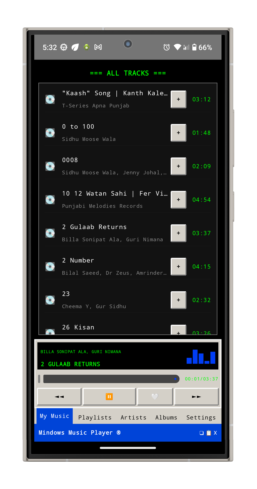
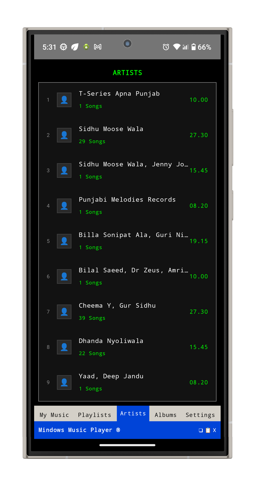
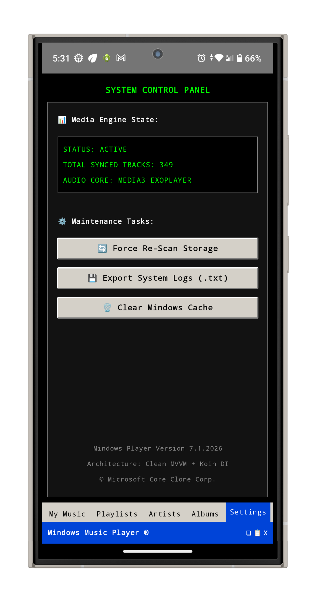

# 🎵 Mindows Music Player 📼

Tags: Android, Jetpack Compose, Kotlin, Room DB, Media3 ExoPlayer, Koin DI, KSP, Unit Testing

---

## 📱 Screenshots & UI Showcase

| My Music (All Tracks) | Now Playing Mini-Player | Full WMP Player View |
| :---: | :---: | :---: |
|  |  |  |

| Artists Explorer | Albums Explorer | Retro Control Panel |
| :---: | :---: | :---: |
|  |  |  |

---

## 🚀 Key Visual & Feature Highlights

* **🎨 1:1 Figma Precision:** raised/sunken 3D bevel borders, monochromes, and classic pixelated typography.
* **📊 Adaptive WMP Visualizer:** Multi-threaded neon audio wave simulation reacting to hardware play/pause changes.
* **❤️ Visually Synced Like Engine:** Tapping heart toggles between `❤️` and `🤍`, writing straight to Room SQLite database in real-time.
* **🔤 Dynamic Smart Sidebar (0-9 | A-Z):** Auto-scans local files, renders *only* existing alphabet groups, and supports smooth-scroll mapping.
* **⚙️ Retro Control Panel:** Live Force Re-Scan Storage, Cache Cleanup, and **Export System Diagnostics Log (.txt File)**.

---

## 🛠️ Modern Tech Stack (Production-Grade Android Standard)

This application is engineered using clean unidirectional data flow and zero legacy boilerplates:

| Component | Technology | Role in Architecture |
| :--- | :--- | :--- |
| **Language** | Kotlin 2.1+ | Modern, safe, and fully asynchronous syntax base. |
| **UI Framework** | Jetpack Compose | 100% declarative UI layout with smooth animated Tab bounds. |
| **Dependency Injection** | Koin Android (4.0.0) | Ultra-lightweight locator engine for structured scoping. |
| **Audio Core** | Jetpack Media3 ExoPlayer | Handles Background Services, Lockscreen Audio, and Notifications. |
| **Local Storage** | Room DB + KSP | SQLite abstraction layer compiled via lightning-fast **Kotlin Symbol Processing**. |
| **Image Loading** | Coil 3 (Compose) | Multi-threaded asynchronous hardware-accelerated album artwork loading. |
| **Data Source** | MediaStore API | Fetches device `.mp3` and storage arrays securely using dynamic permissions. |

---

## 📂 Industrial Directory Architecture

```text
com.dev.mindows/
│
├── MindowsApplication.kt     # App Bootstrap (Koin Injection & DB Pre-population)
│
├── data/                       # 🗄️ CORE DATA LAYER
│   ├── local/                  # ContentResolvers, Hardware Scanners
│   │   └── database/           # Room Engine (KSP Daos, SQLite Entities, CrossRefs)
│   ├── model/                  # Immutable Domain Schemas (AudioTrack, AlbumGroup)
│   └── repository/             # Repository Pattern Boundaries (Data Abstraction)
│
├── di/                         # 🛠️ DEPENDENCY INJECTION (Koin DSL Module Registry)
│
├── player/                     # 🎵 AUDIO ENGINE LAYER (Media3 Session Services)
│   └── playback/               # Inter-Process Controller Bridges
│
└── ui/                         # 🎨 PRESENTATION LAYER (Unidirectional Data Flow)
    ├── components/             # Reusable UI Atoms (RetroButtons, AdaptiveWindows, Visualizers)
    ├── screens/                # StateFlow Observers, Custom Grids & MVVM ViewModels
    └── theme/                  # Exact Figma Hex Matrices & Monospace Typography Setup
```

---

## 🚀 Advanced Under-The-Hood Architecture

### 1. Automated Playback Queue (Queue System)
When a track is triggered from **Playlists, Artists, or Albums Sub-Lists**, the entire array is sequentially parsed into `MediaItem` vectors. This injects a complete queue into ExoPlayer, enabling native **Auto-Play Next Track** mechanics out of the box.

### 2. Smooth Draggable SeekBar Engine
To eliminate playback lagging during thumb-scrolling, the slider uses an isolated local dragging state (`isDragging`). It detaches from the player's periodic ticker during tracking, updating timestamps seamlessly before triggering a final hardware `seekTo`.

### 3. Safe Sub-List Back-Press Handler
Leverages Compose `BackHandler` lifecycle boundaries to intercept physical gesture inputs. If a sub-list folder or the full player is open, it collapses smoothly without triggering a terminal process exit on the host activity.

---

## 🧪 Robust Automation & Test Suite

The system maintains structural integrity using an automated, test-driven validation model:

```kotlin
// Snippet from ExplorerViewModelTest.kt validating clean state mutation
@Test
fun selectArtist_updatesSelectedArtistStateCorrectly() = runTest {
    val artistName = "Mac DeMarco"
    viewModel.selectArtist(artistName)
    assertEquals(artistName, viewModel.selectedArtist.value)
}
```

* **Local Unit Tests (`src/test`):** Powered by **JUnit** and `kotlinx-coroutines-test` dispatchers to evaluate isolated state management inside `ExplorerViewModel`.
* **Instrumented UI Tests (`src/androidTest`):** Leverages `ui-test-junit4` Compose rules to simulate virtual clicks, ensuring animated `WmpTabBar` merges seamlessly into the blue footer under active UI interaction.

---

## ⚙️ How to Build, Compile, and Run

1. Clone this repository to your local system:
   ```bash
   git clone https://github.com/RaviYadavO4/Mindows.git
   ```
2. Launch **Android Studio (Ladybug / Iguana or later)** and open the directory.
3. Allow Gradle to automatically download **Koin 4.0.0**, **Media3 1.5.0**, and boot up the **KSP compiler plugin**.
4. Hook up a physical Android device or Emulator running Android 8.0 (API 26) or later.
5. Launch the app, accept runtime storage permission, and enjoy your music Windows 95 style! 🎉
